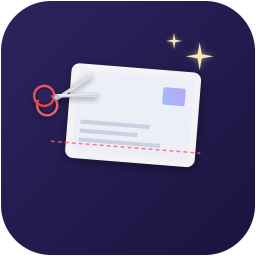
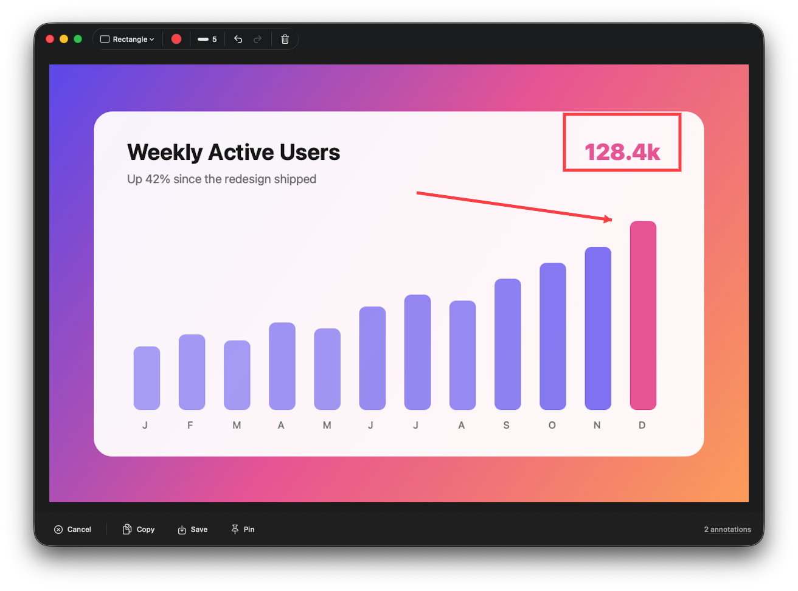
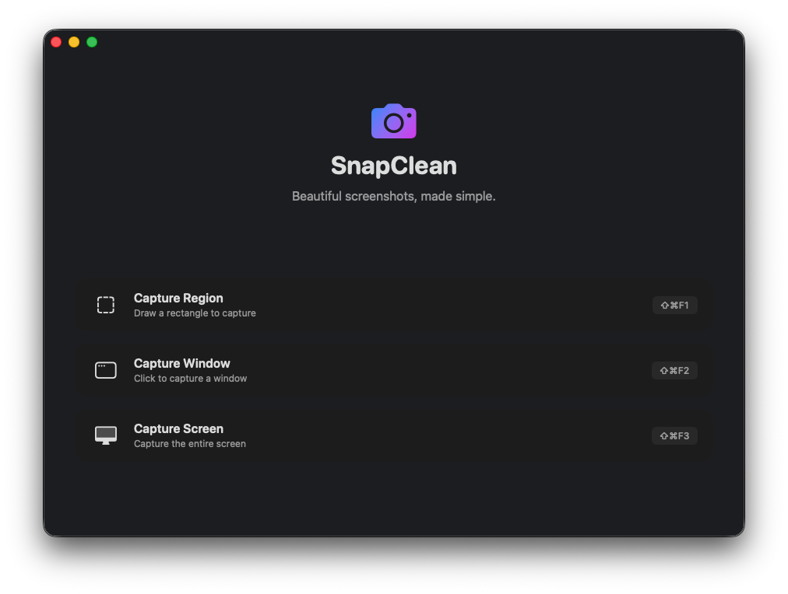

<div align="center">



# SnapClean

**Snap it. Mark it up. Ship it.**<br>
A fast, native macOS screenshot tool that lives in your menu bar.

[](https://github.com/joeynyc/SnapClean/actions/workflows/ci.yml)


[](LICENSE)



</div>

## ✨ What it does

|  |  |
| --- | --- |
| 🎯 **Capture anything** | A region, a single window, or the whole screen, using ScreenCaptureKit. |
| ✏️ **Mark it up** | Arrows, text, boxes, ovals, lines, freehand, plus blur and pixelate for anything private. |
| ↩️ **Change your mind** | Full undo and redo while you annotate. |
| 📥 **Lands in Downloads** | Saves go straight to `~/Downloads` and never overwrite an existing file. |
| 🕘 **History** | Your last 50 shots, ready to copy, reveal in Finder, or pin. |
| 📌 **Pin to screen** | Float a screenshot above every app while you work from it. |
| ⌨️ **Your shortcuts** | Record your own global hotkeys in Preferences. |
| ⏱️ **Timer or instant** | Use a 3, 5, or 10-second countdown for full-screen shots, or turn it off. |

<div align="center">

</div>

## ⌨️ Shortcuts

| Shortcut | Action |
| --- | --- |
| <kbd>⇧</kbd><kbd>⌘</kbd><kbd>F1</kbd> | Capture region |
| <kbd>⇧</kbd><kbd>⌘</kbd><kbd>F2</kbd> | Capture window |
| <kbd>⇧</kbd><kbd>⌘</kbd><kbd>F3</kbd> | Capture screen |
| <kbd>⌘</kbd><kbd>Z</kbd> / <kbd>⇧</kbd><kbd>⌘</kbd><kbd>Z</kbd> | Undo / redo |
| <kbd>⌘</kbd><kbd>C</kbd> | Copy |
| <kbd>⌘</kbd><kbd>S</kbd> | Save |
| <kbd>Esc</kbd> | Cancel a capture |

You can change the capture shortcuts in **Preferences → Shortcuts**.

## 📥 Install

1. Download the `.dmg` from the [latest release](https://github.com/joeynyc/SnapClean/releases/latest).
2. Open it and drag **SnapClean** to **Applications**.
3. Launch SnapClean and allow **Screen Recording** when macOS asks.

SnapClean needs macOS 14 Sonoma or later and runs natively on Apple silicon and Intel Macs.

## 🛠️ Build from source

You need Xcode 26 or later and [XcodeGen](https://github.com/yonaskolb/XcodeGen).

```bash
brew install xcodegen
git clone https://github.com/joeynyc/SnapClean.git && cd SnapClean
xcodegen generate
./build.sh run
```

| Command | What it does |
| --- | --- |
| `./build.sh build` | Debug build |
| `./build.sh test` | Run the unit tests (CI runs the same thing) |
| `./build.sh run` | Build and launch the newest Debug build |
| `./build.sh dmg` | Signed, notarized release DMG in `build/` |
| `./build.sh archive` | Release archive in `build/` |
| `./build.sh clean` | Clean build products |

Run `xcodegen generate` again whenever `project.yml` changes. The Xcode project is generated from it.

<details>
<summary><b>🔐 Permissions</b></summary>

SnapClean needs **Screen Recording** permission to capture your screen. It may also ask for **Accessibility** permission so global shortcuts work.

1. Open **System Settings → Privacy & Security → Screen & System Audio Recording**.
2. Turn on **SnapClean**.
3. Quit SnapClean and open it again.

If SnapClean still says Screen Recording is blocked, remove its entry from that list. Then add the app you just built and relaunch it.

</details>

<details>
<summary><b>✍️ Code signing</b></summary>

`project.yml` signs the app with Apple Development and a fixed team. If you build under a different Apple Developer account, change `DEVELOPMENT_TEAM`, then run `xcodegen generate` again.

Keep the signing identity the same between builds. macOS links privacy permissions to the app's signature, so ad-hoc builds can ask for Screen Recording again after every rebuild.

</details>

<details>
<summary><b>🗂️ Project layout</b></summary>

```text
SnapClean/
  Models/       AppState, screenshot and annotation models, hotkey shortcuts
  Services/     ScreenCaptureKit capture, image effects, global hotkeys
  Views/        SwiftUI windows, capture overlay, annotation editor
  Windows/      AppKit controllers for the capture overlay and the floating pin
  Protocols/    Service protocols, used to swap in test doubles
SnapCleanTests/ Unit tests
project.yml     XcodeGen project definition
build.sh        Build, test, run, archive, clean
```

</details>

<details>
<summary><b>🧪 Manual test checklist</b></summary>

- Region, window, and full-screen captures open in the editor with the right orientation and scale.
- Window capture selects app windows, not the desktop.
- Blur and pixelate show up in the saved and copied image.
- Save writes to `~/Downloads` and adds the shot to History.
- Pin floats above other apps and closes cleanly.
- History can open, copy, copy the path, show in Finder, and delete. Deleting moves the file to the Trash.
- A custom shortcut works globally, and the old shortcut stops working.
- The permissions screen recovers after you grant access in System Settings.

</details>

## 📦 Releasing

Push a version tag (`git tag v1.0.0 && git push origin v1.0.0`) and GitHub Actions builds, notarizes, and publishes the DMG. [docs/RELEASE.md](docs/RELEASE.md) covers the one-time signing setup.

## 📄 License

SnapClean is released under the [MIT License](LICENSE).
